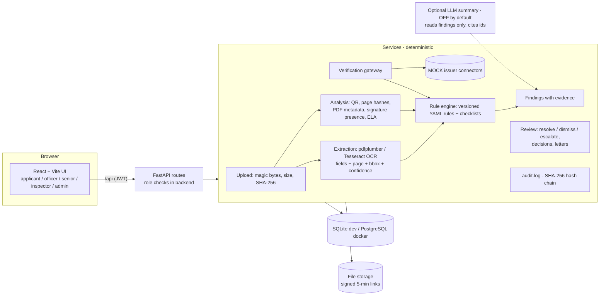

# Validex (SIH prototype)

AI-assisted application and document pre-validation for AICTE Extension of Approval (EoA) scrutiny.
It pre-validates, flags, verifies and explains. **Authorised officials make every final decision.**

> Hackathon prototype. **Not an official AICTE system** and not endorsed by any government body.
> All data is SYNTHETIC. Checklists and rules are ILLUSTRATIVE, not taken from the official handbook.

Project rules: [CLAUDE.md](CLAUDE.md). Shared contracts: [docs/CONTRACTS.md](docs/CONTRACTS.md).
API summary: [docs/api-contract.md](docs/api-contract.md).

## Architecture



Every write that matters goes through `audit.log()`. The LLM (if enabled) never feeds the rule engine.

## Reset the demo (one command)
```bash
./scripts/reset-demo.sh            # Docker; works offline once images are built
./scripts/reset-demo.sh --build    # rebuild images first
./scripts/reset-demo.sh --local    # local SQLite dev
.\scripts\reset-demo.ps1          # Windows PowerShell equivalent (-Build, -Local)
```
Then follow `docs/DEMO.md` (4-minute script + judge Q&A). Full feature guide with every account: `docs/DEMO_GUIDE.md`.

## Evaluation
```bash
docker compose exec backend python -m scripts.evaluate --out /tmp/eval-results.md   # Git Bash: prefix MSYS_NO_PATHCONV=1
docker compose cp backend:/tmp/eval-results.md docs/eval-results.md
```
Runs on a fresh temp database, never touches demo data. Results (`docs/eval-results.md`) are optimistic because
the data is team-generated; the hard examples show where it breaks.

## Ports
| Service | URL |
|---|---|
| Frontend | http://localhost:5173 |
| Backend API + Swagger | http://localhost:8000/docs |


## Option A: Docker (Postgres)
```bash
docker compose up --build        # seeds automatically on start (idempotent)
docker compose down              # stop
docker compose down -v           # stop AND wipe the database (clean demo start)
```

## Option B: Local dev (SQLite, Windows / Git Bash)
Backend (needs Python 3.11+; on Windows use the `py` launcher):
```bash
cd backend
py -3.12 -m venv .venv
.venv/Scripts/pip install -r requirements.txt     # macOS/Linux: .venv/bin/pip
cd ..
backend/.venv/Scripts/python seed/seed.py --reset # create tables + SYNTHETIC seed
cd backend
.venv/Scripts/python -m uvicorn app.main:app --reload --port 8000
```
Frontend (Node 20+), in a second terminal:
```bash
cd frontend
npm install
npm run dev        # http://localhost:5173, proxies /api to 127.0.0.1:8000
```
OCR for scanned documents needs Tesseract. It is in the Docker image. Locally without Tesseract, scanned
files are marked `failed` with a clear reason and their checks show as "could not complete" (never guessed).

## Demo path (about 3 minutes)
1. Log in as `applicant@validex.demo` -> **Start application** -> upload files from `seed/output/demo_upload/`
   (e.g. `fire_noc__expired.pdf`, `affidavit__valid.pdf`, `land_document__valid.pdf`) -> **Run pre-check**.
2. Upload `faculty_list__valid.pdf` -> **Submit application** (official validation runs on submit).
3. Log in as `officer@validex.demo` -> open the case -> **Start scrutiny** -> **Show evidence and explanation**
   (page image with the region highlighted) -> check **Issuer verification: submitted vs source (MOCK)** ->
   **Resolve / Dismiss / Escalate** each critical/high finding with a reason (an expired NOC gives two:
   the printed date EXP-001 and the MOCK issuer's confirmation VER-002) -> **Mark scrutiny complete**.
4. Open the **SYNTHETIC ... Mockingnagar** case in the queue: an altered fire NOC shows an issuer mismatch on the
   expiry date plus a preliminary indicator (PDF modified after creation).
5. Open the **SYNTHETIC ... Trialwadi** case: the same land document and five faculty IDs also appear in another
   institution's application (cross-application preliminary indicators). Try **Draft deficiency letter**.
6. Log in as `inspector@validex.demo` -> open the flagged case -> add a note and an evidence file with a label.
7. Log in as `senior@validex.demo` -> overview (status counts, ageing, common findings, expiry forecast,
   time-saved estimate with its assumption) -> **Rule editor** -> change a value -> Validate -> Save as new version ->
   **Re-run on open cases** (old runs are kept).
8. Log in as `admin@validex.demo` -> **Verify chain** on the audit log.

Note: when automating the UI with headless Chrome, logging in through the form as the inspector can leave the
tab without input focus (a browser prompt). Use a token login for automation; real browsers are unaffected.

The seed also creates 18 SYNTHETIC applications in every status (expired NOC, missing document, name mismatch,
TER pending, scanned NOC, intake increase without accreditation, altered NOC, signed PDF, issuer pending /
timeout, same file in two slots, documents shared with another institution, ...). `seed/output/manifest.json` lists the
expected findings per document and scenario; `python seed/seed.py --reset` prints expected vs actual.

## Demo accounts (SYNTHETIC, password `demo1234`)
| Role | Email |
|---|---|
| applicant | applicant@validex.demo |
| scrutiny_officer | officer@validex.demo |
| senior_authority | senior@validex.demo |
| inspector | inspector@validex.demo |
| admin | admin@validex.demo |

## Tests
```bash
cd backend
.venv/Scripts/python -m pytest -q          # OCR test is skipped without Tesseract
docker compose exec -e DATABASE_URL=sqlite:////tmp/test.db backend python -m pytest -q   # everything, incl. OCR
```

## Regenerate contracts after changing schemas or routes
```bash
cd backend
.venv/Scripts/python -m scripts.export_schemas   # writes docs/schemas/*.json and docs/api-contract.md
```

## What is real vs MOCK / SYNTHETIC (after Phase 3)
| Part | Status |
|---|---|
| JWT login, 5 roles, backend role checks | Real |
| Hash-chained audit log + `GET /api/audit/verify` | Real (tamper-evident, not immutable) |
| Upload validation (magic bytes, 10 MB, SHA-256), short-lived file links | Real |
| Extraction: pdfplumber text layer, Tesseract OCR for scans, page + bbox + confidence | Real (tuned on our synthetic layouts) |
| Rule engine (YAML, validated, versioned per run), checklists | Real engine; rule/checklist CONTENT is ILLUSTRATIVE |
| Institutions, users, documents | SYNTHETIC (generated by `seed/`) |
| Institute record (TER payment, deficiency status) | MOCK record on the SYNTHETIC institution |
| Issuer verification gateway, six statuses, submitted-vs-source view | Real gateway; every issuer source is **MOCK** |
| QR decoding (OpenCV), page hashes, PDF metadata, signature presence | Real; signature is "present, not validated" |
| Anomaly indicators | Real, conservative, labelled "preliminary indicator", staff only |
| ELA (JPEG only) | Implemented, but did not detect our simulated edits; weak signal (see docs/model-cards.md) |
| Review-priority score, alerts, rule editor with versioning | Real |
| Cross-application matches, expiry forecast, senior overview, deficiency letter (template) | Real |
| Inspector notes / evidence and infrastructure advisory | Real; advisory = evidence present + labels read, no measurement |
| Time-saved counter | ESTIMATE from stated assumptions (shown on screen), not measured |
| AI fallback reader for poor scans (Groq vision, `qwen/qwen3.8-27b`) | Optional, OFF by default; suggestions only - rules ignore them until an officer confirms |
| AI case summary (Groq, `openai/gpt-oss-120b`) | Optional, OFF by default; cites finding ids; never used for validation |

### Optional AI features (Groq)
Create a file named `.env` in the repo root (it is git-ignored):
```
GROQ_API_KEY=gsk_your_key_here
AI_FALLBACK_ENABLED=true
LLM_SUMMARY_ENABLED=true
```
then `docker compose up -d` (or `./scripts/reset-demo.sh`). Without the key everything else works; the AI panels
say "unavailable".
- **AI fallback reader:** when OCR misses a field, is unsure, or is not installed, page 1 of the scan is sent to the
  Groq vision model, which returns the printed value of each field (or null). Values appear as **AI-read
  suggestion** with confidence 0.60; the region is highlighted when the same text is found by OCR. **No rule and no
  issuer comparison uses them** until an officer clicks **Confirm** (or **Correct**), which is audited
  (`field.confirmed`). Until then the affected checks show as "awaits officer confirmation".
- **AI case summary:** reads only stored findings and must cite their ids; uncited points are dropped.
- Both use Groq structured outputs (strict JSON schema). Enabling them sends synthetic page images / finding text to
  Groq. Model ids can be changed with `VISION_MODEL` / `SUMMARY_MODEL` (Groq's preview models change often).

## Security notes (only what is implemented)
- Passwords hashed with bcrypt. JWT (HS256) with an 8 hour expiry; set `JWT_SECRET` for any shared deployment.
- Every protected route checks the role in the backend; the frontend route guard is UX only.
- Audit events are SHA-256 hash-chained. Editing or deleting a row is detected by `verify_chain()`.
  Removing only the newest rows is not detectable from the chain alone.
- Anomaly indicators, verification details and the priority score are filtered out for applicants in the backend.
- Not implemented (do not claim): encryption at rest, digital signature validation, rate limiting.

## Final checklist (Phase 4, 2026-10-26)
| Check | Result |
|---|---|
| Backend tests | 139 passed in Docker (with OCR); 138 passed + 1 OCR test skipped locally |
| Audit hash chain verifies after reset + full demo path (headless browser) | valid, 417 events |
| Seed scenario check (expected vs actual findings) | 18/18 match in Docker; eval in docs/eval-results.md |
| Offline demo | reset script works without `--build`; frontend loads no external resources; LLM off |
| No secrets committed | `.env` git-ignored; only demo password for SYNTHETIC accounts; JWT secret from env |
| No real data | all institutions, people, IDs and documents are generated and labelled SYNTHETIC |
| Forbidden wording | no "fraud"/"forged" in UI, code or logs (a test asserts it); no Approve/Reject labels |
| Disclaimer | footer on every page: prototype, not an official AICTE system |

## Prototype limitations
- Tables are created with `create_all` (no migrations). Reset with `seed.py --reset` or `docker compose down -v`.
- Extraction runs synchronously in the upload request (a few seconds for OCR). Fine for a demo; use a job queue beyond that.
- Field extraction relies on "Label: value" lines and is tuned to our synthetic layouts; real documents vary far more.
